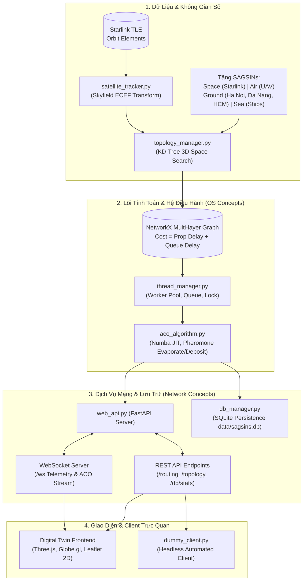

# 🛰️ SAGSINs ACO — Adaptive Routing for Space-Air-Ground-Sea Integrated Networks

> **Đồ án PBL4: Chuyên ngành Hệ Điều Hành & Mạng Máy Tính**  
> *Mô phỏng định tuyến thích nghi trên mạng không gian đa tầng SAGSINs bằng thuật toán Tối ưu hóa đàn kiến (Ant Colony Optimization) kết hợp kiến trúc đa luồng và Digital Twin 3D thời gian thực.*

---

## 📌 1. Giới Thiệu Tổng Quan

Trong kỷ nguyên mạng 6G, **SAGSINs (Space-Air-Ground-Sea Integrated Networks)** là mạng tích hợp đa tầng đóng vai trò xương sống cho kết nối viễn thông toàn cầu. Tuy nhiên, định tuyến trong SAGSINs đối mặt với nhiều thách thức lớn:
- **Topo mạng biến động liên tục**: Vệ tinh quỹ đạo tầm thấp (LEO) di chuyển với vận tốc cực lớn (~7.6 km/s), liên tục thay đổi vị trí không gian và các đường liên kết ISL (Inter-Satellite Links).
- **Môi trường dị thể**: Liên kết gồm 4 tầng (Vệ tinh, Thiết bị bay không người lái UAV, Trạm mặt đất và Tàu biển) với độ trễ truyền lan và đặc tính hàng đợi khác nhau.
- **Rủi ro đứt gãy cao**: Sự cố che khuất, thời tiết hoặc trục trặc phần cứng yêu cầu thuật toán phải có khả năng **chuyển hướng động (Dynamic Rerouting / Failover)** tức thì.

Dự án này ứng dụng thuật toán **Ant Colony Optimization (ACO)** kết hợp các nguyên lý cốt lõi của **Hệ Điều Hành** (Đa luồng, Đồng bộ khóa, Hàng đợi điều phối) và **Mạng Máy Tính** (Mô hình trễ ECEF, QoS, WebSocket Streaming, SQLite Analytics) cùng giao diện **3D Digital Twin** trực quan.

---

## 🌟 2. Các Tính Năng Nổi Bật

- 🌐 **3D Digital Twin & 2D Geographic Map**:
  - Giao diện không gian 3D tương tác chân thực (Three.js & Globe.gl) với lớp bề mặt Trái Đất độ phân giải cao, bầu trời sao, quỹ đạo vệ tinh LEO và hiệu ứng đường truyền quang học.
  - Chuyển đổi linh hoạt 1-click giữa **Quả địa cầu 3D** và **Bản đồ phẳng 2D (Leaflet.js)**.
  - Tự động hiển thị Smart Labels, chỉ báo trạng thái nút (Active / Disabled / Congested).
- ⚡ **Multi-threading OS Engine**:
  - Tối ưu hóa theo mô hình Worker Pool đa luồng (`threading.Thread`, `queue.Queue`).
  - Ma trận Pheromone mảng 1D (`numpy flatten`) thân thiện với CPU L1/L2 Cache, được bảo vệ tránh xung đột tranh chấp dữ liệu (Race Condition) bằng `threading.Lock`.
  - Tích hợp nhân tính toán tăng tốc **Numba JIT (`@njit`)** cho phép mô phỏng hàng nghìn bước kiến di chuyển trong vài mili-giây.
- 🛰️ **Theo Dõi Vệ Tinh Thời Gian Thực (TLE Orbit Propagation)**:
  - Phân tích dữ liệu thực tế TLE của chòm vệ tinh **Starlink** bằng thư viện `skyfield`.
  - Quy đổi tọa độ trắc địa thời gian thực sang hệ tọa độ địa tâm ECEF (Earth-Centered, Earth-Fixed) 3 chiều.
  - Xây dựng đồ thị liên kết không gian bằng cấu trúc cây chỉ mục không gian `scipy.spatial.KDTree`.
- 🛡️ **Mô Phỏng Sự Cố & Tự Động Chuyển Tuyến (Fault Injection & Self-Healing)**:
  - Cho phép người dùng trực tiếp vô hiệu hóa (tắt/bật) bất kỳ nút vệ tinh hay trạm thu phát nào trên bản đồ để kiểm thử độ bền bỉ.
  - Hệ thống tự động phát hiện đứt gãy và kích hoạt bầy kiến tìm tuyến đường cứu hộ (Failover Rerouting) ngay lập tức.
- 📊 **Cơ Sở Dữ Liệu SQLite & Báo Cáo QoS Bền Vững**:
  - Tự động lưu vết toàn bộ lịch sử tìm đường, thời gian hội tụ, số bước nhảy (hop count), độ trễ truyền lan, độ trễ hàng đợi và RTT vào `data/sagsins.db`.
  - Cung cấp API trích xuất thống kê và nhật ký phân tích phục vụ báo cáo thuyết minh.
- 📈 **Bộ Thí Nghiệm & Định Lượng Hiệu Năng (Benchmark Suite)**:
  - So sánh trực tiếp chất lượng đường đi giữa **ACO** và **Dijkstra**.
  - Xuất biểu đồ phân tích độ hội tụ (Convergence Curve) và độ nhạy siêu tham số ($\alpha, \beta, \rho$, số lượng kiến) dạng ảnh PNG độ phân giải cao và bảng CSV.

---

## 🏛️ 3. Kiến Trúc Hệ Thống



---

## 📂 4. Cấu Trúc Thư Mục

```
c:\PBL4\
├── backend/
│   ├── aco_algorithm.py       # Thuật toán ACO lõi, ma trận Pheromone, Numba JIT kernel
│   ├── benchmark.py           # Kịch bản thực nghiệm đo lường hiệu năng (ACO vs Dijkstra)
│   ├── db_manager.py          # Lớp lưu trữ SQLite, quản lý schema, lưu vết QoS và sự cố
│   ├── satellite_tracker.py   # Tính toán vị trí vệ tinh từ TLE sang ECEF và WGS84
│   ├── thread_manager.py      # Bộ điều phối bầy kiến đa luồng (Worker Pool, Lock, Queue)
│   ├── topology_manager.py    # Xây dựng topo 4 tầng SAGSINs, KD-Tree liên kết không gian
│   └── web_api.py             # Máy chủ FastAPI, WebSocket streaming, RESTful API
├── frontend/
│   ├── index.html             # Giao diện chính: Chế độ 3D Globe và 2D Leaflet map
│   ├── network_map.js         # Xử lý render 3D Three.js, liên kết ISL, hiệu ứng định tuyến
│   ├── style.css              # Giao diện Cyberpunk Glassmorphism hiện đại
│   ├── lib/                   # Thư viện Three.js và Globe.gl ngoại tuyến
│   └── textures/              # Texture bề mặt Trái Đất (Blue Marble, Night, Clouds, Topology)
├── client_nodes/
│   └── dummy_client.py        # Kịch bản mô phỏng client gửi yêu cầu định tuyến qua REST/WS
├── tests/
│   └── test_sagsins.py        # Bộ kiểm thử tự động (Unit test) xác thực toàn bộ hệ thống
├── data/
│   ├── starlink.tle           # Dữ liệu 60 vệ tinh Starlink thực tế
│   └── sagsins.db             # Cơ sở dữ liệu SQLite lưu lịch sử chạy (tạo tự động)
├── results/                   # Thư mục xuất biểu đồ PNG và dữ liệu đo lường CSV
│   ├── aco_vs_dijkstra_cost.png
│   ├── convergence_curve.png
│   ├── parameter_sensitivity.png
│   └── benchmark_comparison.csv
├── .gitignore                 # Bỏ qua file rác, __pycache__, virtualenv và local DB
├── requirements.txt           # Danh sách thư viện Python phụ thuộc
└── README.md                  # Tài liệu hướng dẫn sử dụng và thuyết minh dự án
```

---

## 🧮 5. Cơ Sở Lý Thuyết Thuật Toán ACO

Mỗi con kiến khi đứng tại nút $i$ sẽ chọn nút lân cận $j$ tiếp theo theo phân phối xác suất:

$$P_{ij} = \frac{[\tau_{ij}]^\alpha \cdot [\eta_{ij}]^\beta}{\sum_{k \in \mathcal{N}_i} [\tau_{ik}]^\alpha \cdot [\eta_{ik}]^\beta}$$

Trong đó:
- $\tau_{ij}$: Nồng độ **Pheromone** lưu trên cạnh $(i, j)$, đại diện cho tri thức tập thể của bầy kiến qua các thế hệ.
- $\eta_{ij} = \frac{1}{\text{Cost}_{ij}}$: Thông tin **Heuristic** cục bộ, tỉ lệ nghịch với chi phí liên kết:
  $$\text{Cost}_{ij} = \text{Propagation Delay}_{ij} + \text{Queuing Delay}_j$$
- $\alpha$: Trọng số ảnh hưởng của vết Pheromone (mặc định = $1.0$).
- $\beta$: Trọng số ảnh hưởng của thông tin Heuristic độ trễ (mặc định = $2.0$).

### Cơ chế bay hơi và bồi đắp Pheromone:
Sau mỗi vòng lặp ($Iteration$), Pheromone trên toàn mạng sẽ bay hơi để tránh rơi vào tối ưu cục bộ:
$$\tau_{ij} \leftarrow (1 - \rho) \cdot \tau_{ij}$$
*(với $\rho$ là hệ số bay hơi, $0 < \rho < 1$, mặc định = $0.1$)*.

Sau đó, chỉ các liên kết thuộc đường đi tốt nhất ($\text{Best Path}$) mới được tăng cường Pheromone:
$$\tau_{ij} \leftarrow \tau_{ij} + \frac{Q}{L_{\text{best}}}$$
*(với $Q$ là hằng số nồng độ, $L_{\text{best}}$ là tổng chi phí đường đi tốt nhất)*.

---

## 🚀 6. Hướng Dẫn Cài Đặt & Vận Hành

### Yêu Cầu Môi Trường
- **Python**: Phiên bản `3.10` trở lên.
- **Trình duyệt**: Hỗ trợ WebGL (Chrome, Edge, Firefox, Brave).

### Bước 1: Khởi tạo môi trường ảo và cài đặt thư viện
```powershell
# Di chuyển vào thư mục dự án
cd C:\PBL4

# Tạo môi trường ảo (nếu chưa có)
python -m venv .venv

# Kích hoạt môi trường ảo
.\.venv\Scripts\Activate.ps1

# Cài đặt các thư viện cần thiết
pip install -r requirements.txt
```

### Bước 2: Khởi động Máy chủ Web API & Giao diện 3D
```powershell
python backend/web_api.py
```
Máy chủ sẽ lắng nghe tại `http://localhost:8000`.

- 🖥️ **Mở giao diện ứng dụng**: Truy cập trình duyệt tại **[http://localhost:8000/](http://localhost:8000/)** hoặc **[http://localhost:8000/ui/](http://localhost:8000/ui/)**
- 📖 **Xem tài liệu Swagger API tương tác**: **[http://localhost:8000/docs](http://localhost:8000/docs)**

### Bước 3: Chạy Client mô phỏng (Tùy chọn)
Chạy script giả lập trạm gửi yêu cầu tìm đường tự động:
```powershell
# Gửi yêu cầu qua REST API thông thường:
python client_nodes/dummy_client.py --src GND_Ha_Noi --dst SHIP_1

# Nhận phản hồi thời gian thực qua kênh WebSocket:
python client_nodes/dummy_client.py --src GND_Ha_Noi --dst SHIP_1 --ws
```

### Bước 4: Chạy kiểm thử tự động (Unit Tests)
```powershell
pytest tests/ -v
```

### Bước 5: Chạy Benchmark và xuất biểu đồ thực nghiệm
```powershell
python backend/benchmark.py
```
Biểu đồ PNG và bảng CSV định lượng chi tiết sẽ được tự động lưu vào thư mục `results/`.

---

## 📡 7. Danh Mục API Endpoints Chính

| Phương thức | Đường dẫn API | Mô tả |
| :--- | :--- | :--- |
| `GET` | `/routing?source={src}&dest={dst}` | Chạy ACO tìm đường tối ưu giữa 2 trạm/nút bất kỳ |
| `GET` | `/topology` | Lấy danh sách toàn bộ các nút, liên kết và trạng thái mạng |
| `POST` | `/topology/node/{node_id}/toggle` | **Fault Injection**: Vô hiệu hóa hoặc kích hoạt lại 1 nút mạng |
| `POST` | `/topology/node/{node_id}/congest` | Giả lập tắc nghẽn hàng đợi tại 1 nút cụ thể |
| `GET` | `/db/stats` | Thống kê số lượng truy vấn, RTT trung bình từ cơ sở dữ liệu SQLite |
| `GET` | `/db/history?limit=20` | Xem lịch sử chi tiết các lần định tuyến gần nhất |
| `POST` | `/benchmark/run` | Kích hoạt kịch bản chạy benchmark từ giao diện |
| `WS` | `/ws` | Kênh kết nối WebSocket đẩy dữ liệu bầy kiến và telemetry thời gian thực |

---

## 👥 8. Thông Tin Đồ Án & Tác Giả

- **Học phần**: Đồ án Công nghệ Thông tin 4 (PBL4)
- **Đề tài**: Nghiên cứu và hiện thực hóa thuật toán tối ưu hóa bầy kiến định tuyến thích nghi trong mạng tích hợp không gian - trên không - mặt đất - biển (SAGSINs).
- **Nhóm thực hiện**: PBL4 Team
- **Năm thực hiện**: 2026
